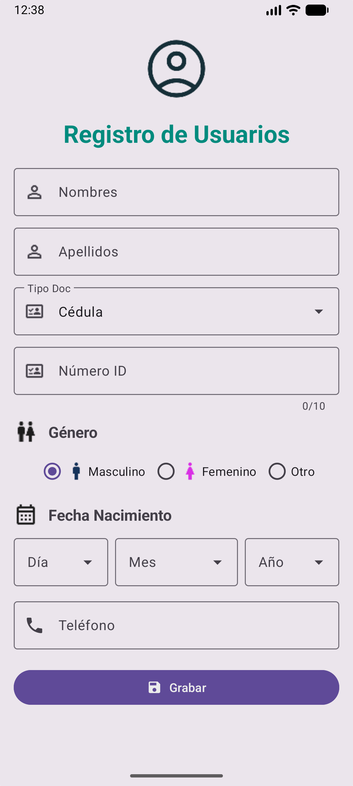
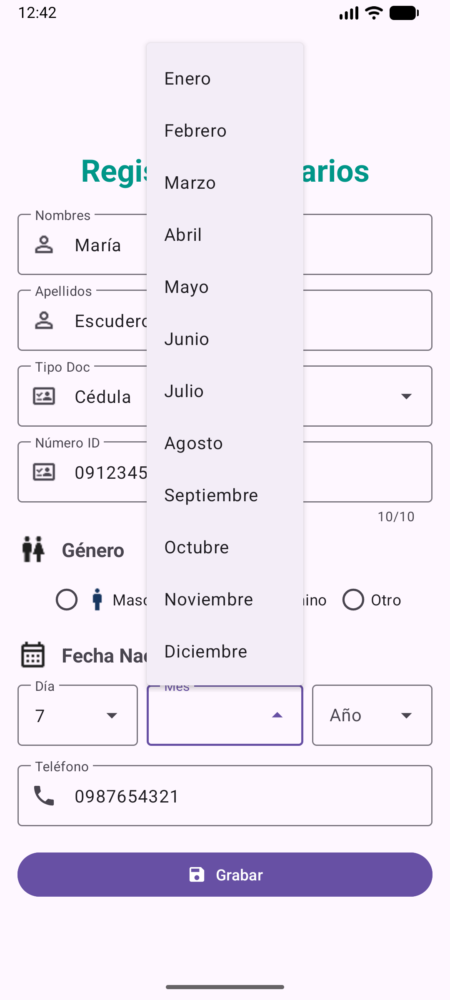
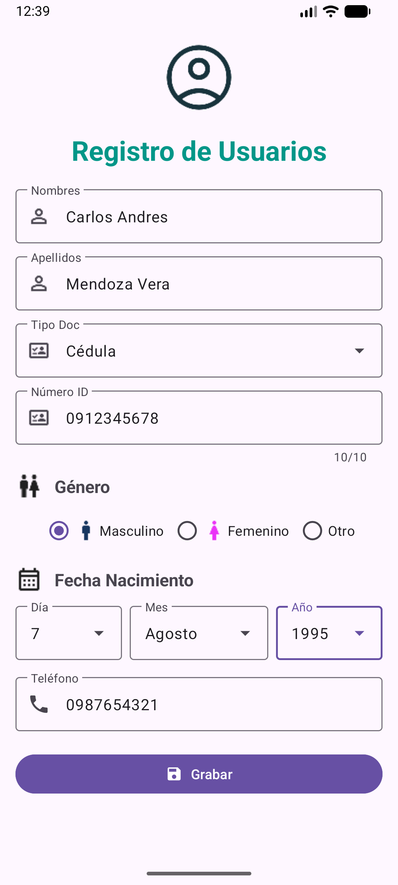
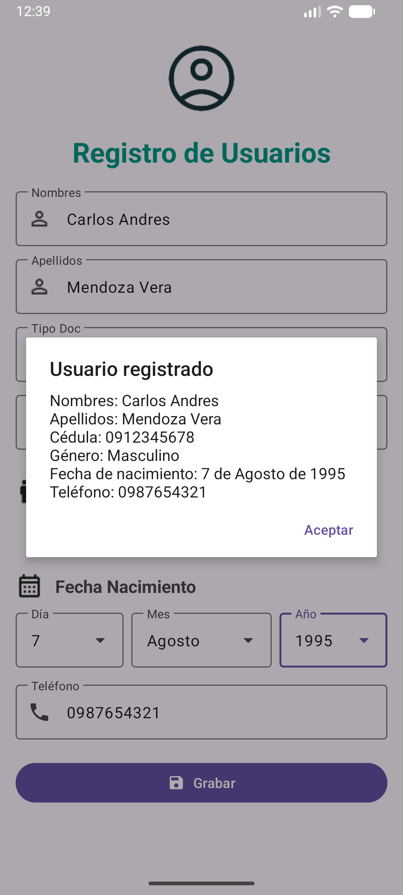

# Práctica 2. Escudero Plaza María del Rosario

## Capturas de pantalla (emulador)

| Pantalla inicial | Lista desplegable (Mes) |
|---|---|
|  |  |

| Formulario lleno | Al pulsar "Grabar" |
|---|---|
|  |  |

## Estructura principal

- `app/src/main/res/layout/activity_main.xml` – diseño del formulario (`ScrollView` + `ConstraintLayout`)
- `app/src/main/java/com/uteq/software/registro_usuario_app/MainActivity.kt` – carga de listas, validación y botón Grabar
- `app/src/main/res/drawable/` – iconos usados en el formulario

## Cómo ejecutar

1. Abrir el proyecto en Android Studio.
2. Sincronizar Gradle.
3. Ejecutar en un emulador o dispositivo con Android API 37.
